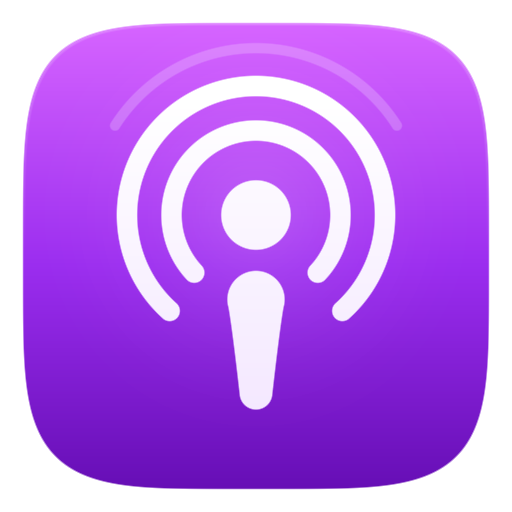

<div align="center">
  
  <h1>My Podcasts</h1>
  <p>Windows 上的 Apple Podcasts 桌面封装客户端，轻巧简洁，打开即听。</p>
</div>

---

## 特色功能

- **一键换区**：顶部随时切换美区 / 国区 / 日区 / 英区，无需切换系统或账号，即可浏览各地榜单和搜索节目。
- **跨设备同步**：支持登录 Apple ID，同步订阅、收藏、待播队列、收听历史以及各页面的播放进度与已播完状态。
- **沉浸播放视图**：封面取色渐变背景、动态过渡效果，支持查看逐字文稿（点击即跳转）和章节时间轴；无文稿时简洁展示封面与大尺寸控制区。
- **悬浮快捷菜单**：单集省略号（`...`）支持鼠标停留自动预览、移走消失，左键点击可固定显示，支持插播、加入队列、收藏、标记已播完、复制链接等操作。
- **顺手好听**：支持多倍速播放、记忆关闭前的播放进度与页面状态，适配明暗主题与系统媒体键。

---

## 下载使用

前往 **[GitHub Releases](https://github.com/kelsilib/my-podcasts/releases)** 下载（Windows 10 / 11 64 位）：

- **安装版（Setup）**：`my-podcasts-setup-alpha0.0.1-windows-amd64.exe` — 双击向导安装，带快捷方式和卸载入口。
- **便携版（Portable）**：`my-podcasts-portable-alpha0.0.1-windows-amd64.zip` — 解压即用，数据保存在同目录 `data` 文件夹。

---

## 自行编译

需要安装 [Go 1.27+](https://go.dev/dl/)：

```powershell
# 1. 获取源码
git clone https://github.com/kelsilib/my-podcasts.git
cd my-podcasts

# 2. 直接运行
go run .

# 3. 打包安装版 + 便携版（产物输出到 dist\release\）
powershell -ExecutionPolicy Bypass -File .\scripts\package-windows.ps1
```

---

## 说明

本项目为第三方非官方 Apple Podcasts 封装软件，与 Apple Inc. 无关，仅作学习与日常收听使用。基于 [MIT License](LICENSE) 开源。
